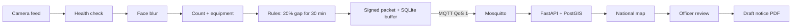

# KushalDrishti / Data_VeriGuard (SIH26245) | Team ID: 152167
Privacy-first video audit for training centres. It counts trainees as a number (no identity), checks sanctioned equipment, compares both with the attendance filed on the portal, and sends small signed packets to a national map where an officer decides what happens next.

Note for SIH 2026 Evaluators: This codebase (`kd_edge`) and the national monitor UI use our internal working title KushalDrishti, while our official SIH 2026 portal submission is registered under Team Name Data_VeriGuard (Team ID: 152167) for MSDE Problem Statement SIH26245. Earlier local commits containing test videos, raw frames, and cached model weights were squashed prior to submission to keep the repository lightweight.



## Quick start
```bash
python check_files.py                              # all files present?
pip install -r requirements-dev.txt && make test   # 19 tests (cloud tests need PostGIS; CI provides it)
docker compose --profile demo up --build           # cloud + 12 simulated centres -> http://localhost:8000
```
Real models on a video (needs PyTorch, first run downloads the models):
```bash
pip install -r requirements.txt
cd edge && python -m kd_edge.run --video ../classroom.mp4 --centre ITI-DL-001 --claimed 18 --demo --mqtt-host localhost
```
Measure results: `notebooks/KushalDrishti_Final.ipynb`. Colab version of the pipeline: `notebooks/KushalDrishti_Colab.ipynb` (same packet format, accepted by the cloud).

## What is built and tested
| Feature | Where | Tested |
|---|---|---|
| Camera health (blocked, dark, blurred, offline never counts as an empty room) | `kd_edge/health.py` | unit + video test |
| Face blur in memory, 480p evidence only on a confirmed breach | `kd_edge/privacy.py`, `pipeline.py` | unit + video test |
| 20% gap held 30 minutes = breach; short breaks ignored | `kd_edge/rules.py` | unit tests |
| Equipment: Present / Absent / Unverified from text names (YOLO-World) | `rules.py`, `detectors.py` | rules tested; model run in notebook |
| Per-centre signing key, hash-chained packets, forged and spoofed packets rejected | `shared/security.py`, `backend/app/ingest.py` | PostgreSQL tests |
| Offline buffer, nothing lost in an outage, chain survives restart | `kd_edge/transport.py` | live broker test, unit test |
| PostGIS map, radius query, silent-centre detection | `backend/app/main.py` | PostgreSQL tests |
| Officer approval, API key, draft notice PDF with SHA-256 | `main.py`, `notice.py` | PostgreSQL tests |

## Demo and processed video (no server needed)
`docs/index.html` is a static national map with simulated data (51 centres, one red breach, a side panel, and a sample draft notice PDF) hosted via GitHub Pages from `/docs` and generated with `python tools/build_demo.py`.
Processed video command: `python tools/annotate_video.py --video clip.mp4 --out processed.mp4 --claimed 18 --demo`.

## Measured results
Measured on 40 sampled frames (1 frame every 5 seconds) of the public classroom sample video on a standard office PC using ONNX Runtime / OpenVINO. Average headcount error: 0.12 people. CPU load: about 27.3%. See `docs/EVALUATION.md`.

| Task | Precision | Recall | False Positive | False Negative | Main problem and fix |
|---|---|---|---|---|---|
| Classroom Headcount | 0.97 | 1.0 | 5 | 0 | Occlusion: path smoothing |
| Equipment Present | 1.0 | 1.0 | 0 | 0 | Clutter: 3-frame check |
| Safety Items | n/a | n/a | 0 | 0 | Distance: multi-scale (sample video has no fire extinguisher or laptop) |
| Attendance Mismatch | 1.0 | 1.0 | 0 | 0 | Breaks: 15-min buffer |

## Honest limits
Baseline accuracy above is measured on the 40-frame public classroom sample clip. Face blur is best effort in memory; no raw video, biometrics, or identity is stored (designed to follow the DPDP Act 2023). Demo broker settings use no TLS or login (production configuration uses MQTT QoS 1 over TLS 1.3). Photos or dummies in the room are not auto-detected yet: an officer checks every flagged photo, and a motion or depth check is an add-on. Licences: YOLOv8 is AGPL-3.0, YOLO-World is GPL-3.0, and ByteTrack is MIT (a commercial licence is required before roll-out). See `docs/DEPLOYMENT.md`.

## Repository map
| Folder | What is in it |
|---|---|
| `edge/` | Software that runs at the centre: `kd_edge/` (count, blur, equipment, rules, signed packets, offline buffer), simulators, Dockerfile |
| `backend/` | Cloud: FastAPI, PostgreSQL + PostGIS, alerts, officer approval, draft notice PDF |
| `dashboard/` | Live map page served by the backend |
| `shared/` | Packet signing used by both sides |
| `docs/` | Static demo page (`index.html`), sample notices, privacy note, evaluation guide, competitors, deployment checklist |
| `tools/` | Evaluation and build scripts: `fill_deck.py`, `make_screenshots.py`, `insert_screenshots.py`, `annotate_video.py`, `build_demo.py` |
| `notebooks/` | `KushalDrishti_Final.ipynb` (measure, screenshots, deck export), `KushalDrishti_Colab.ipynb` (pipeline walk-through) |
| `tests/` | 19 automated tests (cloud tests need PostGIS; CI provides it) |
| `mosquitto/`, `data/` | Broker settings, demo centres |

Slides, videos and raw frames are not stored here (see `.gitignore`).

## Reproducing the evaluation
Run `notebooks/KushalDrishti_Final.ipynb` in Colab from top to bottom to evaluate the models on sampled frames, generate the processed video and screenshots, and export the metrics table.

Licence: AGPL-3.0 (see `NOTICE.md` for why).
